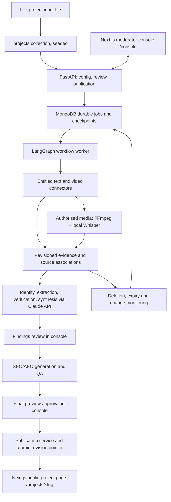

# Architecture and technology decisions

This specification applies to the five-project, single-release, standalone POC. The product's AI agents are bounded application components. The coding assistant used to build the product (Claude Code) and the runtime model provider (Claude API) are separate concerns; both happen to be Anthropic products.

## Service boundaries



One repository, two applications and one database:

- `backend/` — Python. Entry points: API (Uvicorn), workflow worker, scheduler. Agents are logical components inside the worker, not microservices. Separate worker pools for media only if throughput requires it.
- `web/` — Next.js (App Router, TypeScript). `/console/*` is the authenticated moderator console; `/projects/[slug]` is the public, server-rendered project page that reads the active eligible revision through a backend read endpoint at render time and is revalidated on demand by the publication worker.
- `mongodb` — Docker Compose service running as a single-node replica set so multi-document transactions and change streams are available locally and in the demo environment.

## Stack baseline

| Area | Selection | Implementation rule |
|---|---|---|
| Backend | Python 3.12+ (current supported release), FastAPI, Pydantic 2, Uvicorn, `uv` or `pip-tools` lockfile | Pin at Step 03. Generate OpenAPI from request/response models. |
| MongoDB access | PyMongo (async API where the handler is async; sync client in the worker if the checkpointer needs it) | Preserve BSON types; ISO-8601 UTC externally. |
| Agent workflow | LangGraph with the MongoDB checkpointer | Durable graph state plus application jobs; checkpoints are not a scheduler. |
| Model gateway | Anthropic Python SDK behind an application interface (`backend/app/agents/gateway.py`) | Messages API only. Structured outputs through the JSON-schema output format (`client.messages.parse()` with Pydantic types) for extraction/synthesis agents; strict tool use for tool-calling agents. Prompt caching for repeated evidence context; Message Batches API for bulk offline classification. Reference: https://platform.claude.com/docs/en/build-with-claude/structured-outputs |
| Model roles | `MODEL_ROUTINE`, `MODEL_REASONING`, `MODEL_DIFFICULT` in config | Initial values from DECISIONS.md D10; verify with the Models API at Step 03; change only through evaluation (Step 08). |
| Speech-to-text | `faster-whisper` (local, CPU acceptable for POC volumes) on authorised files only | Record model size, language hint and quality flags per segment. Hosted STT is a recorded decision if needed. |
| Embeddings | None in the first retrieval build (filters + MongoDB text index); then local `BAAI/bge-m3` via `sentence-transformers`, frozen model/dimension | Application-side cosine ranking over a capped candidate set. Voyage AI is the hosted alternative. Native MongoDB vector search only if the pinned server build supports it. |
| Discovery | Brave Search API, direct platform APIs, contracted listening provider | Each connector is `access_pending` until its credential is configured and a real query is demonstrated. |
| Extraction | Firecrawl and/or Playwright adapters for permitted domains | Adapters follow the scraping policy in docs/06. A fetching tool does not confer data rights. |
| Media | FFmpeg + faster-whisper; bounded frame extraction | Only process permitted files; cap duration, bytes, frames and concurrency. |
| Web app | Next.js, TypeScript, Tailwind CSS, shadcn/ui, TanStack Query/Table, Zod, TipTap | Types generated from OpenAPI. The public page must render without a live model call. |
| Authentication | Own: `users` collection (argon2/bcrypt hashes), roles, signed HTTP-only session cookie issued by the backend, CSRF token on mutations | Seed users by CLI script. No dev bypass outside explicit fixture mode. |
| Quality | pytest, contract tests, Vitest/Playwright for web, k6 for capacity | Pin only tools used by real checks. |
| Operations | Structured JSON logs, OpenTelemetry (exporter optional), persisted run/cost records, console operations screens | Avoid storing raw source text in traces. |
| Packaging/CI | Docker Compose (mongodb, api, worker, scheduler, web); GitHub Actions for lint/type/test/build | No cloud infrastructure work. |

Do not install every optional library. Use the smallest stack that meets the contracts. Do not introduce Redis, Kafka, Kubernetes, a second database, another orchestration framework or a second frontend without a recorded decision.

## Proposed repository layout

```text
backend/app/api/                 HTTP endpoints, auth dependencies, public read endpoint
backend/app/domain/              models, state transitions and business invariants
backend/app/repositories/        MongoDB reads, writes and indexes
backend/app/connectors/          platform/provider/scraping adapters
backend/app/media/               transcription, alignment and frame processing
backend/app/retrieval/           deduplication, evidence search and ranking
backend/app/agents/              model gateway, specialist implementations, structured outputs
backend/app/workflows/           graph, checkpoints, jobs, leases and scheduling
backend/app/editorial/           content generation, validation and previews
backend/app/publication/         activation, page revalidation, verification, rollback
backend/app/observability/       redaction, metrics and tracing
backend/tests/                   unit, integration, contract and recovery checks
web/app/console/                 moderator console routes
web/app/projects/[slug]/         public project page (server components)
web/components/, web/lib/        shared UI and generated API client
evals/                           versioned fixture manifests and evaluation code
prompts/                         reviewed prompt templates and versions
scripts/                         seed users, seed projects, DB setup, local checks
docker-compose.yml, .env.example, .github/workflows/
```

## Configuration contract

Step 03 creates a documented, validated configuration: MongoDB URI/database, session signing secret, `ANTHROPIC_API_KEY`, model role IDs, per-provider keys and capability flags (absent key ⇒ `access_pending`), Whisper model size, embedding model/dimension, run budgets, job leases, refresh/lookback settings, allowed fetch hosts, public page base URL and revalidation secret. Commit only `.env.example`.

Live mode fails clearly when a required setting is absent. Fixture mode must be explicit, visually identified in the console, and unable to publish to the public page.

## Version freeze record

Record each runtime/library version, why it is compatible, lockfile location, official reference and date tested in DECISIONS.md. Before calling the combination validated, run in the local environment: a real structured-output request to the configured model, a LangGraph checkpoint save/resume against the replica set, and a transaction commit/abort.
