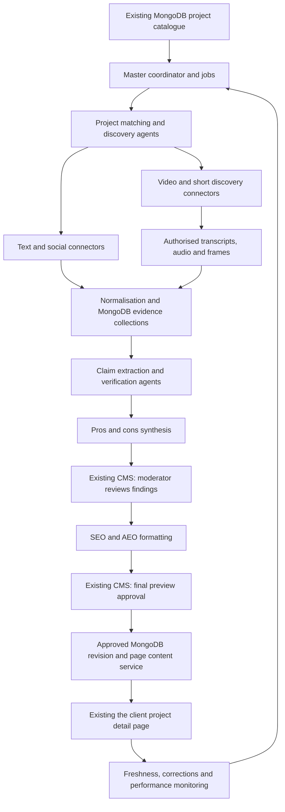

# the client — Agentic Project Intelligence Platform

Implementation blueprint for one complete five-project POC release. Revised 24 September 2026 to reflect the confirmed MongoDB and CMS architecture. Cloud integration is outside this scope.

Build a managed workflow that discovers project discussion, preserves the evidence, produces defensible pros and cons, supports editorial review, and publishes approved content into the existing the client project detail pages. The “Master Model” is the orchestration layer coordinating specialised AI agents, data connectors, and business rules. Foundation models are used through APIs; project knowledge comes from retrieved evidence and the the client catalogue.

All core capabilities in this document belong to one POC release. Work packages can run concurrently, with internal test builds and staging demonstrations, followed by one end-to-end release for the five selected projects. The POC must demonstrate discovery through CMS moderation and approved page display.

**1. Planning assumptions and launch scope**

- Confirmed: the POC covers five projects. For each, the user supplies project name, alternate names, locality, micromarket and city. Map these to the existing MongoDB project ID before collection. Developer, phase and regulatory references can be read from MongoDB where available; they are not additional required user inputs.
- Proposed operating defaults: manual refresh plus daily incremental collection, an initial 90-day discovery window, and 1–3 CMS moderators. These defaults remain configurable.
- Initially evaluate English, Hindi, and Hinglish input; publish English content. Add other required regional languages to the launch acceptance dataset before committing them to scope.
- MongoDB is the source of truth for existing project records. Store the new evidence, claims, drafts, review decisions and publication references in separate AI collections linked by project ID. Agent services read the existing project collection and write to their designated AI collections.
- The existing CMS is the moderator workspace and controls approve/disapprove, editing and publication. Extend it with an AI Project Insights section; a separate moderator application is not required.
- Reuse existing CMS authentication and page-rendering mechanisms. Their exact interfaces and frontend framework remain to be inspected during implementation.
- Exclude cloud selection, cloud provisioning, cloud migrations and cloud integrations. Package the API and worker for the team's existing execution environment.
- Include textual discussions, video/short discovery, authorised media analysis, evidence search, pros/cons synthesis, moderation, SEO/AEO formatting, publishing, refresh, correction, rollback, monitoring, and operating documentation in the same release.
- Define a named launch source matrix. “All social platforms” is an extensibility objective; no provider can be assumed to expose every public item, private group, comment, or transcript. A mandatory source with unavailable access is a launch dependency, not a silently omitted capability.
- Coverage is measured against authorised sources and a human-curated benchmark, not against an unknowable total of all online conversation.

**2. Architecture and ownership**

Use a modular backend with separately scalable API, connector, AI, and media worker processes. Agents are logical components with separate prompts, tool permissions, outputs, and evaluations; they do not each require a separate microservice or separately trained model.

Use LangGraph to define the master workflow, agent nodes, branching, checkpoints and pauses for CMS decisions. Persist checkpoints through the MongoDB LangGraph checkpointer. Use the OpenAI Python SDK inside agent nodes for model calls and structured outputs. MongoDB documents this persistence integration, and LangGraph supports interrupt/resume for human input. [MongoDB integration](https://www.mongodb.com/docs/atlas/ai-integrations/langgraph/), [LangGraph interrupts](https://docs.langchain.com/oss/python/langgraph/interrupts)

An application worker claims persisted jobs from an `ai_jobs` collection. Use atomic job claiming, a worker lease with heartbeat/expiry, retry counters, a unique project/time-window key and recovery from the latest checkpoint. An existing scheduler, or one dedicated scheduler process, inserts daily jobs. LangGraph checkpoints alone do not supply a distributed job scheduler or guarantee exactly-once side effects. Publishing and ingestion writes must therefore be idempotent. For five projects, begin with one worker and tightly bounded connector concurrency.

Suggested deployables:

| Component | Responsibility |
|---|---|
| Existing CMS extension | Project setup, evidence exploration, moderation, previews, operations |
| Core API | Authentication, catalogue, records, moderation, publication contracts |
| Connector workers | API access, pagination, cursors, quota enforcement, deletion updates |
| AI workers | Bounded specialist execution, extraction, synthesis, quality checks |
| Media workers | Authorised audio processing, transcript alignment, frame extraction |
| Publication adapter | Validates CMS approval and activates the approved MongoDB content revision through the existing content service |
| Workflow worker | Coordinates runs and CMS decisions using LangGraph and MongoDB checkpoints |

The CMS backend authorises review and publication using the logged-in moderator's permissions. The publication adapter performs the controlled write. Discovery and analysis agents can propose content but cannot approve it or change the live revision pointer.

**3. Recommended technology stack**

“Latest” means a current, supported stable release, with compatible versions pinned and tested together. Version observations below were checked on 24 September 2026. Recheck patch versions and advisories at implementation and release freeze.

| Layer | Proposed technology | Purpose and decision |
|---|---|---|
| Frontend framework | Existing CMS framework; React 19.3 for a new compatible embedded module | Add review screens inside the CMS. Reuse its components and authentication. If the CMS uses another framework, implement the screens in that framework; do not make a CMS rewrite a POC prerequisite. [React releases](https://react.dev/versions). |
| Frontend language/runtime | TypeScript 7.0 for compatible new code; Node.js 24 LTS for a new build/runtime where needed | Respect the existing CMS toolchain. TypeScript 6 compatibility may be needed for compiler-API tools. [TypeScript](https://devblogs.microsoft.com/typescript/announcing-typescript-7-0/), [Node releases](https://nodejs.org/en/about/previous-releases). |
| Design and interaction | Existing CMS design system; TanStack Query/Table, Zod and TipTap where compatible | Evidence tables, typed validation and controlled editing. Tailwind CSS 4.3/shadcn/ui are options only if compatible with the CMS styling. [Tailwind releases](https://tailwindcss.com/blog). |
| Backend | Python 3.14, FastAPI, Pydantic 2, Uvicorn | Typed APIs, validation, AI and ingestion workers. Observed stable baselines include Python 3.14.7 and FastAPI 0.141.1. [Python](https://www.python.org/getit/source/), [FastAPI](https://fastapi.tiangolo.com/release-notes/). |
| Agent execution | LangGraph with the OpenAI Python SDK and Responses API | Explicit agent nodes, controlled tool use, model routing and structured outputs. |
| Workflow persistence | MongoDB LangGraph checkpointer plus persisted application jobs | Resume interrupted runs, pause for CMS approval and recover expired worker leases. |
| Database | Existing supported MongoDB deployment | Existing project catalogue plus separate AI collections. Verify version/topology and indexes; an upgrade is not required just because a newer release exists. |
| Database access | PyMongo Async API; compatible checkpointer client in the worker | Direct MongoDB access and explicit Pydantic models. Use a synchronous worker/client where a checkpoint library requires it rather than blocking async request handlers. [PyMongo Async](https://www.mongodb.com/docs/languages/python/pymongo-driver/current/reference/migration/). |
| Search and retrieval | MongoDB project/aspect/date filters plus an application embedding similarity step for the bounded five-project corpus | Store embeddings in separate documents and cap candidates before ranking. Use existing MongoDB Search/Vector Search if already available; do not assume every MongoDB edition exposes it. No new hosted database is needed for this POC. |
| Files and media | Existing file service; otherwise an isolated GridFS bucket with expiry/deletion jobs | Keep permitted large transcripts/media separate from project documents. Store references in AI collections. Avoid unbounded arrays and large embedded media payloads. |
| Quotas and deduplication | MongoDB job/provider counters, unique indexes and content hashes | Durable per-source limits and duplicate prevention appropriate to five projects. |
| Web discovery | Brave Search API | URL discovery and query expansion. [API documentation](https://api-dashboard.search.brave.com/api-reference/web/search/post). |
| Web extraction | Firecrawl for approved public domains; Playwright for explicitly permitted custom adapters | Extract permitted page content and preserve provenance. A fetching tool does not confer data rights. [Firecrawl](https://docs.firecrawl.dev/features/scrape). |
| Social listening | Brandwatch Consumer Research API, subject to commercial evaluation | Broader social and forum coverage. Require a contract confirming source coverage and downstream AI/content rights. [Mentions API](https://developers.brandwatch.com/docs/retrieving-mentions). |
| Speech/media | GPT-Transcribe, FFmpeg, transcript alignment worker | Transcribe authorised files, preserve time ranges, and extract frames where useful. [Model documentation](https://developers.openai.com/api/docs/models/gpt-transcribe). |
| Authentication | Existing CMS authentication and role checks | Reuse moderator identities and enforce roles again in the backend. |
| Observability | Structured logs, OpenTelemetry and MongoDB run/cost records | Per-agent timing, errors, evidence counts and spend; connect to existing monitoring if available. Redact sensitive source content. |
| Execution packaging | Docker/Compose for API and worker, or existing application deployment conventions | Reproducible execution without selecting or provisioning a cloud. |
| Delivery | Existing CI system, dependency lockfiles and versioned database setup scripts | Reproducible builds, checks, index/validator changes and application rollback. |
| Testing | pytest, Playwright, contract tests, k6, curated agent evaluation suite | Backend, moderation/publishing journeys, integration behavior, capacity and output quality. |
| POC measurement | CMS review outcomes, source coverage, grounding scores, latency and cost | Existing Search Console/analytics can provide context after publication; search ranking uplift is not an immediate POC success gate. |

These are proposed stack choices, not a claim that the complete combination has already been compatibility-tested. Pin new libraries to supported releases and test against the actual CMS and MongoDB versions. A standalone frontend is unnecessary; if an independently deployed UI were later requested, Next.js 16.3 is a current option, but it is not part of this POC architecture.

**4. AI model routing**

| Workload | Initial model choice | Release validation |
|---|---|---|
| Routine classification, language identification, candidate filtering, simple extraction | GPT-6 Luna | Measure errors by language and aspect, and escalate ambiguous cases. |
| Detailed evidence reasoning, project ambiguity, synthesis and SEO/AEO writing | GPT-6 Sol | Measure attribution, contradiction handling, factual preservation and editorial acceptance. |
| Difficult contradictions and high-impact claim review | GPT-6 Astra | Use selectively, within per-run budgets, with human review for publication. |
| Authorised speech transcription | GPT-Transcribe | Evaluate Hindi/English code-switching, project names, dates, prices, units and numerical errors. |
| Semantic retrieval | text-embedding-3-large | Start with a tested reduced dimension such as 1,536 for compact storage and similarity ranking; freeze model/dimension together. |

The current OpenAI catalogue lists Astra, Sol and Luna for these capability/cost tiers. The proposed workload assignment is an architectural recommendation and must be validated on the client data. [Model catalogue](https://developers.openai.com/api/docs/models), [embeddings documentation](https://developers.openai.com/api/docs/guides/embeddings).

Use strict schema-constrained outputs where supported, followed by Pydantic and business-rule validation. Valid JSON does not establish truth. Handle refusals, truncated responses, unavailable tools, invalid references and empty evidence explicitly. [Structured outputs](https://developers.openai.com/api/docs/guides/structured-outputs)

Store the requested model, returned model identifier, prompt version, schema version, input evidence revision, tool calls, token usage and evaluation version. Use pinned model snapshots when offered. Model or prompt upgrades require regression evaluation; feedback does not automatically retrain the model.

**5. Master coordinator and specialist agents**

| Agent | Inputs and tools | Output and limits |
|---|---|---|
| 0. Master coordinator | Project settings, source entitlements, schedule, run budget | Starts and tracks the workflow, dispatches approved specialist tasks, records partial failures, stops at approval gates. Its state transitions are enforced in code. |
| 1. Project identity agent | Catalogue, aliases, developer, locality, phase/tower, RERA reference, candidate evidence | Project match with supporting signals; ambiguous matches go to review. Project phases must remain distinguishable. |
| 2. Discovery planning agent | Project identity and approved source catalogue | Queries, hashtags, known channels, languages, time windows and source priorities. Connector tools execute collection and pagination. |
| 3. Video understanding agent | Accessible metadata, authorised transcripts/audio, sampled frames | Timestamped observations; distinguishes creator speech, visual evidence, descriptions, and audience comments. |
| 4. Language and context agent | Original text/transcript and conversation context | Preserved original plus normalised text, translation, language tags, negation and sarcasm flags. |
| 5. Aspect and claim extraction agent | Project-matched text segments | Atomic claims about connectivity, construction, possession, amenities, maintenance, density, parking, water/power and value perceptions. |
| 6. Evidence verification agent | Claims, primary records, supporting and contradicting sources | Fact/opinion/allegation/promotional classification, corroboration, conflicts, age and verification status. |
| 7. Pros and cons synthesis agent | Eligible claims and independent-source clusters | Source-linked candidate findings, topic coverage, caveats and insufficient-evidence outcomes. |
| 8. SEO/AEO editorial agent | Moderator-approved findings and existing page context | Readable summary, pros/cons, buyer questions, source links, review date and proposed metadata. Cannot add unsupported facts. |
| 9. Editorial QA agent | Draft, approved findings, evidence map and style rules | Flags unsupported changes, exaggerated wording, missing caveats, duplicate content, questionable attribution and schema mismatch. |
| 10. Freshness and change agent | New items, deletions, publication history and expiry rules | Material-change alerts, stale-claim flags and new review drafts. Publication still follows approval rules. |

Deterministic tools perform fetches, exact hashing, retention checks, schema validation and CMS writes. AI handles ambiguity and language. For every agent, define an input schema, output schema, allowed tool list, maximum steps, timeout, cost budget, fallback and failure state.

Suggested initial execution policy: bounded parallel connector runs; no unbounded recursive agent spawning; one controlled repair of an invalid structured output; provider retries with exponential backoff and jitter; a project-level budget; separate limits for search, text and media. The exact numerical settings come from load tests and approved provider quotas.

**6. Source access and third-party integration plan**

| Source | Integration approach | Launch acceptance evidence |
|---|---|---|
| YouTube videos and Shorts | YouTube Data API for discovery, metadata, available comments and channel monitoring | Real project queries, pagination, quota budget, disabled comments, removed videos, and format identification tested. Duration alone must not establish that a video is a Short. |
| YouTube spoken content | Owner-authorised captions, creator-supplied files, or a licensed transcript/media source with appropriate rights | Actual transcript access and analysis permissions. The official caption-download method requires permission to edit the video. [YouTube caption API](https://developers.google.com/youtube/v3/docs/captions/download). |
| Reddit | Approved commercial API agreement or a provider contract explicitly covering the intended use | Search and comments coverage, allowed AI processing and derived publication, retention and deletion obligations. Commercial access requires Reddit approval. [Reddit terms](https://redditinc.com/policies/data-api-terms). |
| X | X API or the contracted listening provider | Confirm search window, archive entitlement, rate limits, fields, usage charges and content reuse rights. [Search documentation](https://docs.x.com/x-api/posts/search/introduction). |
| Instagram/Facebook/Reels/Threads | Approved Meta endpoints for the authorised use case and/or contracted listening coverage | Demonstrate each promised account/content/comment capability. Broad public coverage remains unconfirmed until a working entitlement test; Meta docs could not be fully retrieved during this research. |
| Public property forums, blogs and discussion pages | Brave discovery plus approved API/RSS/Firecrawl/custom adapter | Domain permissions, thread/reply preservation, timestamps, author roles, deleted content and extraction accuracy. |
| Quora and LinkedIn | Contracted provider, permitted indexed pages, or authorised partner feeds | Verify project-level coverage and allowed use; do not assume unrestricted global discussion APIs. |
| Other short-video platforms | Per-platform licensed connector where commercially available | Add only the sources required for launch with demonstrated access. TikTok Research Tools are not available to ordinary commercial users. [TikTok FAQ](https://developers.tiktok.com/docs/en/research-api-faq). |
| the client catalogue and trusted project facts | Internal APIs plus authorised developer/regulatory documents | Stable project IDs, current facts, effective dates, official sources and phase matching. Do not assume one universal RERA API. |
| the client CMS | Versioned private API or internal content service | Staging write, preview, exact revision approval, idempotent publish, rollback and rendered-page verification. |

For every connector record: provider, platform, content types, fields available, historical depth, languages, refresh window, quotas, authentication, allowed AI processing, allowed derived publication, attribution rules, retention, deletion propagation, cost basis, and operating owner.

Brandwatch is a recommended procurement candidate, not a guarantee of access to all platforms or permission to republish derived content. Validate it against at least 20 representative projects before contract selection. Prefer one primary collection route per platform, and deduplicate overlapping provider/direct feeds.

Represent coverage explicitly as `full_content`, `metadata_only`, `link_only`, `unavailable`, or `access_pending`. Preserve the access reason and last successful sync. A search snippet or video title can help discovery; it cannot support a claim about content that was not analysed.

**7. Data processing and evidence rules**

For each project run:

1. Load canonical identity, aliases, approved sources, historical cursor and publication revision.
2. Generate local-language and alternate-name queries; exclude conflicting developers/localities. Budget the query count before execution.
3. Collect source records with platform IDs, canonical URLs, parent thread relationships, original publication date and collection date.
4. Save permitted snapshots with content hashes and provider policy references. Preserve old source revisions only where retention permits.
5. Resolve project identity using multiple signals. Split multi-project comparisons at segment level. Hold ambiguous items for review.
6. Normalise language, boilerplate and markup while retaining original text, units, names and context. Keep text comments separate from transcript evidence.
7. For authorised media, obtain captions or transcribe audio, align segments to the original timeline, and extract selected frames when visual inspection supports the task. Mark timestamp precision as exact or approximate. Do not infer current construction status from undated promotional renders.
8. Detect exact and near duplicates; group syndicated posts, copied reviews and cross-posted videos into origin clusters. Treat originality and promotional indicators as signals, not proof of authenticity or deception.
9. Extract atomic aspect-level claims with evidence anchors, polarity, speaker/source role, observation date and verification category.
10. Verify factual statements against appropriate primary sources. Record disagreements rather than selecting only favourable evidence.
11. Retrieve supporting and contradicting evidence, using project and time filters before semantic ranking. LLM memory is not a project fact source.
12. Aggregate into findings with independent-origin counts, source mix, date window and caveats. Viral reach does not establish factual accuracy or independent corroboration.
13. Compare against the previous approved revision; prepare a change summary for the moderator.
14. After moderation, generate final editorial content, validate it, obtain final approval and publish the exact approved revision.

Evidence policy proposals to calibrate during evaluation:

- A candidate claim always needs at least one retrievable evidence anchor; a claim described as a recurring opinion should normally have at least three independent origin clusters in the agreed window.
- A single primary source may establish a checkable fact within its authority; three repeated rumours do not establish that fact.
- A single useful subjective observation can remain explicitly attributed and be considered by a moderator. Do not describe it as community consensus.
- Possession dates, prices, approvals and serious allegations require stronger verification and escalation. A creator's sales pitch is attributed promotional content.
- Unknown confidence remains unknown. Calibrate model scores against labelled examples; do not present an LLM's self-assessed number as a probability of truth.
- Preserve substantive negative findings under the same evidence standard as positives. Moderators record reasons for rejections.
- Permit an empty pros or cons list and an `insufficient_evidence` outcome. The system must not manufacture balance or a rating.
- Engagement and sentiment percentages describe the collected sample only. They do not represent all buyers or residents.

**8. Structured JSON and database design**

Use MongoDB collections with stable references for identities, evidence, revisions and decisions. The attached `client-data-example.json` is a synthetic JSON exchange bundle; its sections map to separate MongoDB documents, not one ever-growing project document. `client-data-contract.schema.json` is a proposed Draft 2020-12 API contract. MongoDB collection validators use a different supported JSON Schema subset and BSON types, so translate the applicable constraints rather than installing this file unchanged as a collection validator.

| Record | Required information |
|---|---|
| Project | Existing MongoDB project ID, the client ID, project name, alternate names, locality, micromarket, city; optional developer/phase/RERA enrichment; languages and refresh settings |
| Source item/revision | Platform/native ID, canonical URL, content kind, publication/collection dates, original and normalised text, source role, capture level, content hash, parent item, rights-policy ID, deletion state |
| Project-source association | Project ID, source revision/segment, matching signals, match status, calibrated confidence if available |
| Media segment | Media/transcript ID, original language, text or frame reference, start/end time, timestamp precision, transcription method |
| Evidence span | Source revision, exact excerpt, character or temporal anchor, context, valid/withdrawn state |
| Claim | Project, aspect, statement, polarity, fact/opinion/allegation class, supporting/contradicting evidence IDs, verification result, freshness, confidence basis |
| Finding | Pros/cons/neutral grouping, claim IDs, independent-origin counts, caveats, draft wording and moderator decision |
| Content revision | Immutable revision ID, approved finding IDs, summary, pros, cons, Q&A, source map, review period, locale and hash of the canonical publish payload |
| Review decision | Reviewer identity, target revision/hash, approved/rejected/edit-required status, timestamp, reasons and comments |
| Publication | Project/page ID, content revision/hash, idempotency key, CMS receipt/revision, status, timestamps and rollback pointer |
| Agent task/run | Run and agent IDs, input/output references, prompt/model/schema versions, retries, cost, start/end time, status and error |
| Connector state | Source entitlement, last successful cursor, coverage, quota consumption, failure and next eligible retry |

Proposed collections: existing `projects` (actual name to confirm), `ai_project_configs`, `ai_sources`, `ai_evidence`, `ai_claims`, `ai_findings`, `ai_content_revisions`, `ai_review_decisions`, `ai_publication_state`, `ai_jobs`, `ai_agent_runs`, `ai_source_policies`, `ai_origin_clusters`, `ai_audit_events`, `ai_deletion_requests`, and `ai_evaluations`, plus checkpointer collections. Reuse existing CMS users/roles instead of duplicating identities.

Keep the existing project `_id` type in MongoDB; expose a consistent string representation in API JSON. Store actual BSON dates internally and ISO-8601 UTC timestamps in the API. Add unique indexes on platform/native-ID/revision, project/content-revision and project/job-window keys; add compound indexes on project/status/date and project/aspect. Enforce reference integrity in the backend, since MongoDB does not supply relational foreign keys. Use collection validation, optimistic version checks and per-project access rules. Do not embed unbounded source arrays into existing project documents.

Each published sentence or content block maps to approved claims and evidence. Full raw content, private notes, personal identifiers and internal model traces are excluded from the public payload. The page's content service reads only the revision identified by `ai_publication_state.active_revision_id`; it never selects the latest draft by date.

JSON Schema validates structure. Backend invariants additionally validate reference integrity, current rights, project association, evidence availability, approval hashes, and the legality of state transitions. Build smaller agent-specific output schemas from the canonical definitions; adapt them to the model provider's supported JSON Schema subset.

**9. Existing CMS screens and interactions**

Add an “AI Project Insights” section to the current CMS. The five POC projects appear there, and every screen below is a CMS route, tab or panel. The backend provides JSON to the CMS; it does not require a second content-management system.

| Screen | Required functions |
|---|---|
| Portfolio dashboard | Projects, last successful refresh, source coverage, pending review, stale content, failures and cost |
| Project configuration | Catalogue mapping, aliases, phase/locality, query exclusions, languages, refresh cadence and source selection |
| Evidence explorer | Search/filter by source, aspect, date and language; original/translated text; transcript jump links; origin clusters; provenance and access level |
| Video library | Discovered videos and shorts, platform/channel, project-match status, transcript availability, analysed status and timestamps |
| Findings review | Pros/cons beside evidence; conflicting evidence; approve/edit/reject; rejection reason; ambiguity resolution |
| Content editor | Approved finding references, controlled rich text, version diff, SEO/AEO checks, page preview and final approval |
| Publishing centre | Exact revision/hash, approval status, CMS result, publication history, retry and authorised rollback |
| Operations and quality | Connector health, quotas, run timelines, schema failures, evaluation results and per-project spend |
| Administration | SSO role mapping, source entitlements, thresholds, prompt versions, retention and audit search |

Proposed roles: administrator, researcher, moderator, publisher, and read-only analyst. A small team can give one person moderator and publisher roles while preserving separate recorded actions. Implement accessible keyboard navigation and clear empty, error, stale and partial-coverage states. Drafts and private previews must be access-controlled and excluded from indexing.

**10. Backend API contracts**

Use versioned REST endpoints, generated OpenAPI documentation, cursor pagination, role checks and consistent error objects. Use Server-Sent Events for run progress where helpful.

| Method and endpoint | Purpose |
|---|---|
| `POST /v1/projects/import` | Import or reconcile catalogue records |
| `GET/PATCH /v1/projects/{id}` | Read/update project configuration |
| `POST /v1/projects/{id}/runs` | Start a refresh; return a durable run ID |
| `GET /v1/runs/{id}` | Read state, coverage, errors and cost |
| `GET /v1/runs/{id}/events` | Progress stream |
| `GET /v1/projects/{id}/sources` | Paginated evidence and media records |
| `GET /v1/projects/{id}/findings` | Candidate findings and supporting claims |
| `POST /v1/findings/{id}/decisions` | Record moderator action on a specific finding revision |
| `POST /v1/projects/{id}/content-revisions` | Generate or save a new draft revision |
| `POST /v1/content-revisions/{id}/approvals` | Approve the exact final payload hash |
| `POST /v1/publications` | Publish an approved immutable revision with an idempotency key |
| `POST /v1/publications/{id}/rollback` | Restore a permitted previous revision with a recorded reason |
| `POST /v1/sources/{id}/withdrawals` | Withdraw evidence and trigger dependent-content review |
| `GET /v1/connectors/health` | Coverage, entitlement, quota and failure state |
| `POST /v1/webhooks/{provider}` | Verify signatures and process supported provider/CMS events |

New content revisions use optimistic concurrency to prevent editor collisions. Store review decisions through the authenticated CMS backend, then update the approved publication state with a compare-and-set operation. Where approval and pointer changes cross documents, use a MongoDB transaction on a supported replica set/sharded topology. If the existing deployment is standalone, place the authoritative approval/version/pointer together in one bounded publication-state document and use an atomic update. The implementation must choose and test one of these paths after inspecting the topology.

Persist publication/revalidation jobs and reconcile uncertain responses by idempotency key or revision lookup. A network timeout must not cause duplicate publication. UI display of “approved” is insufficient: the backend verifies the exact approved revision and content hash.

**11. Moderation, SEO/AEO and publishing rules**

Workflow states: `collecting → analysing → findings_review → formatting → final_review → approved → publishing → published`. Additional states include `changes_requested`, `insufficient_evidence`, `partial`, `failed`, `stale`, `withdrawn` and `rolled_back` at the appropriate record level.

The first moderator decision approves findings and factual meaning. The final preview decision approves the SEO/AEO wording that will actually appear on the page. These can be presented within one editorial workspace. Every material edit creates a new revision and invalidates approval of the earlier hash. The API, worker and CMS adapter all enforce this rule.

Recommended page module:

- A short, project-specific overview of the collected discussion, with its time window.
- Clear, evidence-supported advantages and considerations, without forced equal counts.
- Buyer questions with concise answers grounded in approved findings.
- Relevant source links and video timestamps where permitted.
- Last reviewed date, editorial attribution and a short description of the source coverage.
- A correction route connected to the moderation queue.

Prepare a section title, page-context-aware description suggestion, internal links and suitable JSON-LD. Existing page metadata must be changed only through the approved CMS field contract. Retain the canonical project URL. Produce server-rendered or pre-rendered content within the existing page so the module is available in its HTML and does not depend on a live model call.

Use appropriate schema.org entities matching visible content and the existing page graph. Do not create aggregate ratings from scraped sentiment, or misclassify the project as an unrelated entity just to obtain a rich result. Q&A is useful editorial structure. Google's documentation states that there is no special schema requirement for AI features, and its 2026 updates say FAQ rich results were discontinued. [Google AI features](https://developers.google.com/search/docs/appearance/ai-features), [Google documentation updates](https://developers.google.com/search/updates).

Publication path: CMS moderator approves final preview → backend validates current evidence, policy and payload hash → write/confirm immutable approved revision → atomically activate its MongoDB publication pointer → enqueue page-cache revalidation → verify rendered revision. Persist delivery state and retries. If page refresh fails, report the pending delivery accurately; rollback the pointer if the selected recovery policy requires it. Retain previous approved revisions for authorised rollback where evidence remains eligible.

**12. Security, evidence lifecycle and operational controls**

These controls support this product's actual data and publication flow:

- SSO, least-privilege roles, short-lived service credentials where possible, secret rotation, encrypted transport/storage and private database access.
- Source text is untrusted input. It cannot alter system instructions, tool permissions or approval state. Sanitize displayed content and isolate fetched pages/media from the application runtime.
- Fetch only approved public hosts or authorised integrations. Protect against SSRF, unsafe redirects, internal-network access, oversized downloads and unsupported file formats.
- Store only necessary author metadata; preserve platform identity only where permitted and needed for within-platform deduplication. Do not infer residents' identities or connect profiles across platforms.
- Enforce collection, AI-processing, quotation, derived-publication and retention permissions separately. Manual import follows the same rules.
- Maintain source→evidence→claim→content-revision lineage. A deletion, correction or policy expiry invalidates dependent evidence, triggers content review and removes retained data as required.
- Keep decision history append-only, but make source payloads erasable. Backups and object versioning need expiry/deletion procedures; content must not persist indefinitely in logs or traces.
- Use the existing environment's database backup procedure; test application checkpoint recovery, publication rollback, per-source stop switches and worker concurrency controls. New cloud backup architecture is excluded.
- Record operational spend, quota use, source outages, review backlog, source freshness and publication failures with named owners.

**13. Complete build work breakdown — all included in Release 1.0**

**Work package 1 — Requirements, source access and acceptance definition**

1.1 Register the five supplied projects with project names, alternate names, locality, micromarket and city; confirm languages, refresh frequency, history window and user roles.
1.2 Inspect the existing MongoDB catalogue, map each input to its canonical project ID, and obtain CMS/page integration details.
1.3 Select representative projects including ambiguous names, multiple phases, sparse chatter and conflicting feedback.
1.4 Agree source matrix and distinguish mandatory sources from desired coverage.
1.5 Request relevant API access and provider demonstrations; verify AI processing and derived publishing rights.
1.6 Define evidence thresholds, review policy, source retention and correction ownership.
1.7 Agree measurable release acceptance criteria and freeze product scope.

Deliverables: signed scope, connector matrix, sample catalogue, evaluation brief, CMS contract draft and dependency register.

**Work package 2 — UX, architecture and contracts**

2.1 Map user journeys from project setup through correction/rollback.
2.2 Design dashboard, evidence explorer, media library, review and preview screens.
2.3 Document deployment boundaries and workflow state transitions.
2.4 Specify database relations, JSON schemas, agent contracts and API definitions.
2.5 Define content approval hashing and CMS idempotency behavior.
2.6 Review architecture with frontend, backend, AI, editorial and the client website owners.

Deliverables: approved UX, architecture decisions, OpenAPI draft, schema definitions and page module specification.

**Work package 3 — Engineering foundation and MongoDB setup**

3.1 Create repositories/workspaces and pin compatible language/library versions.
3.2 Configure the API and worker in the existing development/staging execution environment and load secrets through its established mechanism.
3.3 Create isolated AI collections, required indexes, validators, job records and checkpoint storage; inspect MongoDB topology and available search features.
3.4 Integrate CMS authentication, roles, audit events and limited database identities.
3.5 Build CI for checks, schema compatibility, container packaging and versioned database setup scripts.
3.6 Configure telemetry, trace redaction, budgets and baseline dashboards.

Deliverables: reproducible API/worker setup, working CMS authentication, MongoDB collection/index setup and a repeatable application release process.

**Work package 4 — Project catalogue and identity resolution**

4.1 Build import/synchronisation with stable the client IDs.
4.2 Store user-supplied city, locality, micromarket and alternate names in the AI configuration; read optional developer, phase/tower and official references from existing data.
4.3 Build query expansion and negative-keyword controls.
4.4 Implement deterministic candidate scoring and AI handling for ambiguous cases.
4.5 Add moderator correction and split/merge association workflows.
4.6 Evaluate wrong-project matches on similarly named projects and mixed-project videos.

Deliverables: searchable project registry and validated matching pipeline.

**Work package 5 — Text and social collection**

5.1 Implement a common connector interface for discovery, fetch, incremental updates and deletion checks.
5.2 Integrate the contracted social provider and approved direct APIs.
5.3 Integrate web search and permitted forum/page adapters.
5.4 Preserve comment/thread context, pagination, publication dates and source roles.
5.5 Add quota handling, cursor checkpoints, retries, token refresh and outage isolation.
5.6 Record actual coverage and reconcile duplicate records from multiple providers.
5.7 Test retention/deletion behavior and missing-field responses.

Deliverables: production-ready collectors for every mandatory launch source and documented coverage.

**Work package 6 — Videos, shorts and multilingual processing**

6.1 Discover videos using project names, aliases, creators, hashtags and known channels.
6.2 Match project references and preserve format certainty; accept unknown format.
6.3 Resolve which captions, transcripts or media files are authorised for analysis.
6.4 Implement audio preparation, transcription, segment timing and quality checks.
6.5 Extract sampled frames/on-screen text only where necessary and permitted.
6.6 Preserve original language, translations, speaker context and separate comments.
6.7 Evaluate numbers, possession dates, unit sizes and Hindi/English code-switching.
6.8 Display unavailable transcripts distinctly and route necessary cases to manual review.

Deliverables: video library, authorised media analysis pipeline and timestamped evidence.

**Work package 7 — Evidence storage, deduplication and retrieval**

7.1 Implement revisioned source records and policy-controlled snapshot storage.
7.2 Create evidence spans with stable text/time anchors.
7.3 Implement exact hashing, near-duplicate detection and origin clustering.
7.4 Build project/aspect/date retrieval filters and bounded embedding similarity ranking; use native MongoDB Search/Vector Search only if already supported by the deployment.
7.5 Create lineage between sources, claims, findings and content revisions.
7.6 Implement stale, deleted, inaccessible and superseded evidence states.
7.7 Test that withdrawn evidence disappears from retrieval and dependent approval eligibility.

Deliverables: searchable evidence repository with provenance and lifecycle controls.

**Work package 8 — Agent development and master workflow**

8.1 Implement each agent's tools, prompts, schemas, limits and escalation behavior.
8.2 Build claim taxonomy and aspect-level extraction.
8.3 Implement fact/opinion/promotion/allegation classification and contradiction handling.
8.4 Build verified-fact retrieval and dated primary-source references.
8.5 Build pros/cons synthesis and insufficient-evidence handling.
8.6 Integrate agents into the durable workflow with bounded concurrency and budgets.
8.7 Implement output validation, resumability, cancellation and operator-visible errors.
8.8 Evaluate model routing and establish baseline prompt/model versions.

Deliverables: evaluated multi-agent pipeline producing traceable draft findings.

**Work package 9 — Moderator application**

9.1 Implement portfolio and project configuration screens.
9.2 Implement evidence search, transcript viewing and source jump links.
9.3 Implement claim/finding approval, edit, reject and escalation actions.
9.4 Add source conflicts, insufficiency, origin counts and freshness indicators.
9.5 Build assignment, review queue, comments and optimistic editing locks.
9.6 Implement role enforcement and audit history.
9.7 Conduct moderator usability sessions with realistic data.

Deliverables: complete editorial console and review operating guide.

**Work package 10 — SEO/AEO content and quality controls**

10.1 Agree voice, content length, section structure and supported languages.
10.2 Generate summary, advantages, considerations and buyer Q&A from approved findings.
10.3 Enforce claim references on every substantive sentence/block.
10.4 Add editorial checks for unsupported numbers, new factual claims, exaggeration and source imbalance.
10.5 Generate appropriate metadata/JSON-LD proposals aligned with existing page content.
10.6 Build final page preview, revision diff and approval of the canonical payload hash.
10.7 Evaluate factual preservation across formatting and manual edits.

Deliverables: publishable, reviewed page module and editorial validation suite.

**Work package 11 — CMS and project-page integration**

11.1 Implement CMS review routes/actions and map draft, approved and active content to the agreed MongoDB collections.
11.2 Integrate the module into the current project-page renderer.
11.3 Implement atomic approval/publication state changes, idempotency keys, conflict detection and persisted page-refresh jobs.
11.4 Add cache invalidation and rendered-content verification.
11.5 Implement unpublish/correction/rollback with role checks and audit trail.
11.6 Verify canonical URL, indexability, structured-data consistency and mobile presentation.
11.7 Test CMS outage, timeout after success and simultaneous editor updates.

Deliverables: end-to-end approved-content publishing and recovery on staging.

**Work package 12 — Evaluation, security and capacity qualification**

12.1 Build a labelled dataset across all five projects, available source families, launch languages, opinions, facts and adversarial examples; target at least 150–300 source items when enough chatter exists.
12.2 Split by source origin and time, and hold out projects for tuning checks where feasible; adjudicate uncertain labels. Sparse coverage is a POC finding, not a reason to invent examples of real chatter.
12.3 Measure matching, extraction, citation support, contradiction recall, translation errors and moderator acceptance.
12.4 Test prompt injection, unsafe HTML, private URL fetching, permission escalation and secret exposure.
12.5 Test provider rate limits, revoked access, deleted sources and schema drift.
12.6 Test all five projects together, including a controlled burst above observed volume, and measure database/retrieval latency and review throughput.
12.7 Run checkpoint recovery, partial-run restart, publish rollback and duplicate-event drills; use the existing backup procedure where available.
12.8 Resolve release-blocking defects and freeze evaluated versions.

Deliverables: evaluation report, security findings closure, load report and recovery evidence.

**Work package 13 — Operations, freshness and analytics**

13.1 Configure incremental schedules and any required high-priority refresh rules.
13.2 Implement material-change detection and source-expiry/deletion follow-up.
13.3 Add connector, quality, cost, freshness, publication and review-backlog alerts.
13.4 Capture a before/after POC quality and cost report; record page and publication dates for optional later comparison with existing analytics.
13.5 Define error ownership, escalation, source replacement and manual fallback procedures.
13.6 Train moderators, publishers and on-call operators.

Deliverables: dashboards, alerts, runbooks, operating owners and editorial training.

**Work package 14 — One complete five-project POC release**

14.1 Complete end-to-end user acceptance on representative and edge-case projects in staging.
14.2 Confirm each agreed POC source entitlement and quota, and show unavailable coverage explicitly.
14.3 Recheck dependency patches, credentials, model availability and provider contracts.
14.4 Approve the release candidate against every acceptance gate.
14.5 Release all API, worker, MongoDB and CMS changes together in the agreed existing environment.
14.6 Execute collection for the five projects, review the findings in the CMS and publish only moderator-approved content through the existing page mechanism.
14.7 Verify the rendered page module, rejection/edit paths, refresh and recovery controls; deliver the POC evaluation report.

Deliverables: a complete end-to-end POC for all five projects, the CMS approval/disapproval workflow, approved page content where evidence supports it, and the evaluation report. Collection, media analysis, moderation, SEO/AEO and approved page display all belong to this single release.

**14. Suggested team and delivery calendar**

Planning estimate: 6–8 weeks with one technical lead/backend engineer, one AI engineer, one backend/integration engineer, one CMS frontend engineer and one QA engineer, plus part-time product/editorial owners and access to the current CMS team. This is an estimate for the bounded five-project POC, assuming usable CMS APIs and source credentials. Access procurement or difficult CMS integration can extend it.

| Weeks | Concurrent work | Completion evidence |
|---|---|---|
| 1 | Five-project mapping, source access, MongoDB/CMS contracts and review UX | Canonical IDs and working access established |
| 2–3 | Text/video collection, media processing, evidence storage and CMS UI | Real authorised evidence available for the five projects |
| 3–5 | Agents, claim verification, synthesis, moderation and editorial formatting | Evaluated findings and final previews in the CMS |
| 4–6 | Approved revision activation, page rendering, refresh and recovery | Complete collection-to-page journey in staging |
| 6–7 | Evaluation, security checks, moderator UAT and defect fixes | Acceptance evidence and measured limitations |
| 8 | One complete POC release and evaluation handover | All core capabilities demonstrated across the five projects |

These are engineering work windows, not separate product releases. Do not commit a fixed launch date until mandatory source access and the CMS contract are confirmed.

**15. Proposed launch acceptance criteria**

These are targets for agreement, not achieved results.

| Area | Gate |
|---|---|
| Source scope | Every mandatory platform capability works against production-entitled test accounts; limitations appear in the UI |
| Project identity | At least 98% precision on auto-accepted project matches in the held-out benchmark; report recall and ambiguity rate alongside it |
| Evidence retrieval | At least 90% recall@10 on the curated evidence-query set, reported separately for each launch language |
| Grounding | 100% of published substantive claims carry traceable evidence links; at least 95% draft claim support in human audit |
| Factual errors | Zero known critical unsupported claims in the release acceptance sample; this is a release gate, not a guarantee of zero future error |
| Approval | All publication attempts without current approval of the exact payload revision are rejected |
| Reliability | Worker interruption, duplicate events and timeout-after-write tests complete without lost approvals or duplicate publication |
| Refresh | 95% of scheduled daily project jobs finish within the agreed window, excluding clearly reported source outages/indexing delays |
| Publication | Approved content reaches the rendered page within five minutes under normal CMS operation |
| UI | p95 common read operations below two seconds at agreed concurrency; media/collection jobs remain asynchronous |
| Recovery | Demonstrated worker restart/resume, failed-source isolation and restoration of the prior approved page revision |
| Editorial throughput | Review workload fits assigned moderator capacity and queue service levels |

Measure performance against fixed, versioned datasets. Report sample sizes, per-language results and confidence intervals where useful. Human audit remains necessary even when an automated reviewer passes a draft.

**16. Sizing and operating-cost model**

For an illustrative planning load of five projects, 50 new relevant text items per project per day, and five newly accessible five-minute videos per project per week:

- About 7,500 new text items per 30-day month.
- About 500 video minutes per four-week month.
- Discovery calls, irrelevant candidates, comments, duplicate records and initial backfill add separate load.
- The selected connector plan must support the search calls, pagination and update/deletion checks required by that load. Approve quota increases before launch; project count alone does not determine quota needs.

POC operating cost = data-provider access + search/extraction calls + transcription minutes + model input/output tokens + incremental existing-environment resources + editorial time. Cloud integration and cloud provisioning estimates are excluded.

Estimate model cost from measured tokens per task and the chosen routing mix. Estimate moderator hours as `changed drafts × average review minutes ÷ 60`. For example, five changed drafts at 12 minutes each require one review hour, before escalations. Cache stable evidence, analyse only changes, deduplicate before model calls, batch suitable tasks, and cap per-project media processing. Treat initial backfill as a separately measured one-time workload. Actual chatter volume may be substantially lower than the sizing example.

Vendor quotes and account quotas are needed before a credible total budget can be committed. Do not infer an enterprise listening licence price from public API pricing.

**17. Decisions to confirm before implementation**

The confirmed foundation is five projects, MongoDB project storage, CMS moderation, and no cloud integration work. Remaining implementation inputs are the five project records; actual MongoDB collection/ID mapping; CMS framework and available extension/API points; source credentials or provider contracts; launch languages; moderator identity/roles; and publication rules. The five input fields supplied by the user are sufficient to start project discovery after canonical MongoDB mapping. A fill-in template is included as `five-project-input-template.json`.
